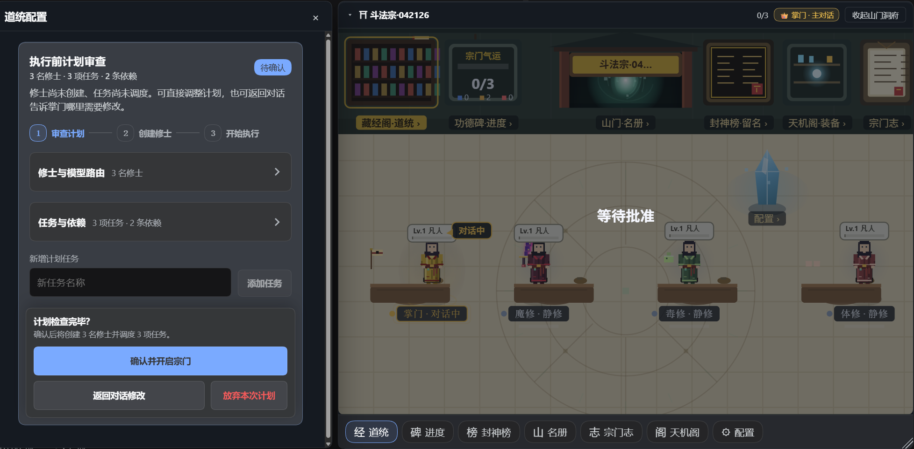
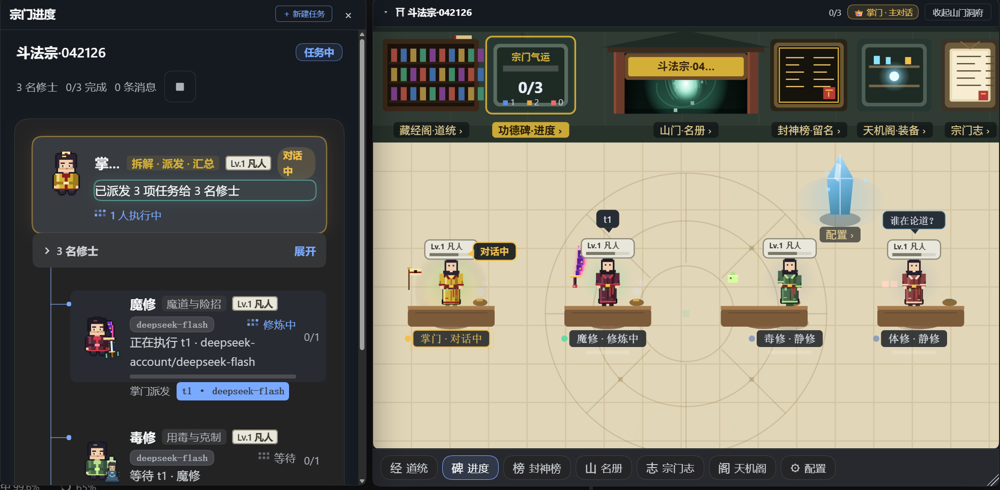
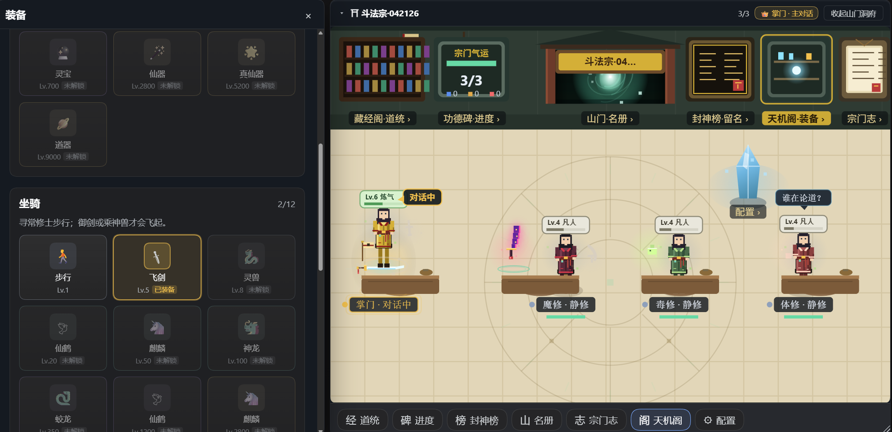
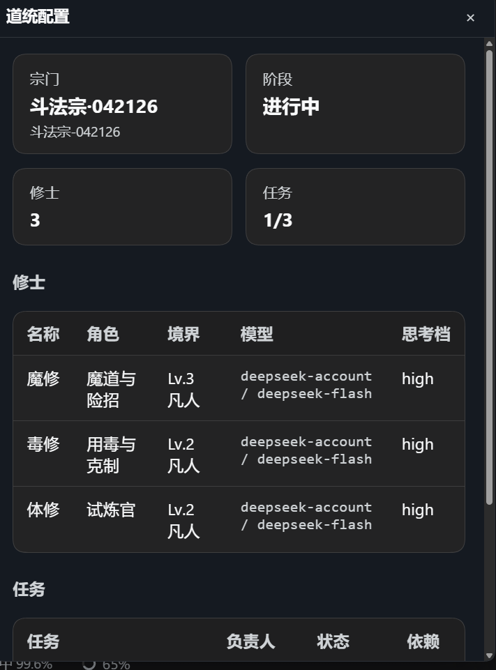
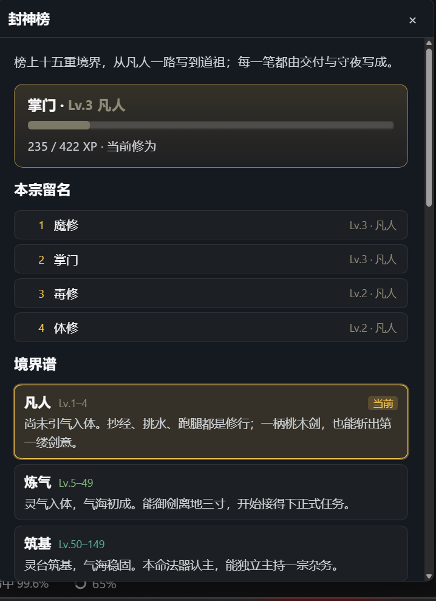
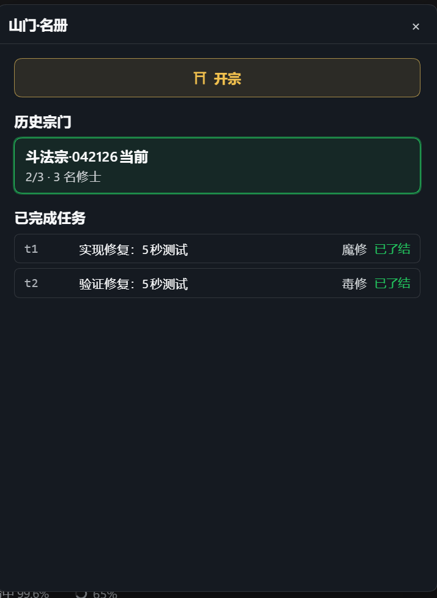

# 🐉 agent-teams-pixel — a pixel cultivation hall for your AI team

**English (default)** · [简体中文](README_ZH.md)

  

▲ 17-second tour — plan review · doctrine · task DAG · equipment · 15 realms · roster

> **One DSH session becomes a sect. A captain, a roster of specialists, a pixel hall you actually want to open.**
>
> Durable agents, dependency-aware tasks, quality gates, and a 15-realm cultivation layer — local-first, MIT, no workflow engine required.

- 🏯 **A hall, not a dashboard** — six clickable wall facilities, a seven-button floor bar, and a living pixel scene for captain + members.
- 🧠 **Real team protocol** — durable subagents, automatic task dispatch, mailbox, retries, cold recovery and independent review.
- ⚔️ **Specialist roles** — frontend, backend, integrator, verifier, reviewer, security; each has a bounded contract and evidence rules.
- 🌱 **Cultivation that means something** — every completed task and idle tick feeds a shared 15-realm ladder; equipment, mounts and skills render in the hall.
- 📜 **封神榜 + 宗门志** — a sect roll, realm ladder, support/community/about and feedback in one place.
- 🔒 **Local-first** — team state lives in your workspace; no cloud account.

## 🎮 What's fun

  
  

<b>Approve before spawn</b> — 3 members, 3 tasks, 2 dependencies; nothing starts until you confirm. · <b>Live task DAG</b> — the captain dispatches t1; 毒修 waits for t1, 体修 waits for t2.

  

<b>Gear that shows up</b> — equip 飞剑 and the captain actually rides it; artifacts, mounts and skills unlock by realm, and the hall redraws instantly.

  
  
  

<b>One sect, three cultivators</b> — role, realm, model and reasoning effort at a glance. · <b>15 realms</b> — from 凡人 to 道祖. · <b>History that stays</b> — completed tasks and the next 开宗 entry.

All screenshots come from a live DSH session. If the hall sticks, a ⭐ helps it keep growing.

<strong>⭐ If the pixel hall makes your agents easier to run, a star helps a lot.</strong> One command: <strong>dsh plugin --profile desktop add agent-teams-pixel@0.3.0-rc.4</strong>

## ⚡ Quick start

**DeepSeek Harness (desktop / web)**

    dsh plugin --profile desktop add agent-teams-pixel@0.3.0-rc.4
    # reopen DSH → open 山门 · 名册

**From GitHub**

    git clone https://github.com/EternalNight996/agent-teams-pixel
    dsh plugin --profile desktop add ./agent-teams-pixel

**CLI / headless**

    dsh --profile desktop
    # ask: 用 AgentTeams 开一个团队做 …

Package version: **0.3.0-rc.4**. Recommended host: DeepSeek Harness **0.2.1-rc.3** (web + headless). See [compatibility.json](compatibility.json) for the exact matrix.

## 🏯 What you get

| Facility | What it does |
|---|---|
| **山门 · 名册** | current sect, roster history and team entries |
| **藏经阁 · 道统** | members, task contracts, staged plans, founding wizard |
| **功德碑 · 进度** | task dependencies, dispatch progress, verification evidence |
| **封神榜** | sect roll, 15 realms, cultivation card, leveling tips, sect story |
| **天机阁** | equipment inventory: artifact / mount / skill, immediate hall preview |
| **宗门志** | support, community, about and a privacy-bounded feedback form |
| **收件** | captain inbox, keyboard reachable and text-escaped |

The wall and the floor bar are two routes into the same panels. Click a cultivator to open their conversation; click their level badge to open gear.

## 🧩 One hall, every entry

| Entry | What you get |
|---|---|
| **Wall** | six facilities: roster, doctrine, progress, 封神榜, gear, 宗门志 |
| **Floor bar** | the same panels plus settings, always one click away |
| **Cultivator** | their conversation; the level badge opens equipment |
| **CLI / headless** | the same tools and durable team state, no UI required |
| **Local state** | workspace state under .agent-teams; no cloud account |

## 🐉 Why this exists

Most agent dashboards are lists. This one is a **place**: the captain’s desk, the gate, the merit stele, the ascension board. You can see who is working, who is idle, what is blocked, and what was delivered — without reading a log.

Under the pixels is a serious team runtime:

- captain-led task DAG with dependency-aware dispatch;
- persistent member sessions, mailbox and attempt ownership;
- quality contracts: objective, scope, acceptance, verify, review verdict;
- independent verifier/reviewer gates, repair rounds and cold recovery;
- per-role contracts that keep frontend/backend/integrator work in disjoint layers.

## 🧩 Roles & templates

| Template | Default roles | Best for |
|---|---|---|
| **Full stack** | integrator · frontend · backend · verifier · reviewer | contract-first features; parallel layers |
| **Security hardening** | auditor · security · verifier · reviewer | repro-before-fix, minimal diff, residual risk |
| **Fix / feature / research / build / docs / debate** | small role sets | everyday team work |
| **Architecture** | architect · implementer · verifier · reviewer | boundaries and migrations |

Each specialist gets a fixed contract: ownership, must / must not, done, five-bullet report, and a working budget. The full-stack team is intentionally five people: the integrator owns both the contract and final integration, cutting one handoff.

## 🧾 Does it actually improve delivery?

| Signal | Evidence |
|---|---|
| Full suite | **pnpm verify** exit 0 |
| Browser-side contracts | **56/56** |
| Publish artifact | package smoke checks runtime + support QRs, excludes source/tests/docs |
| Real team run | captain dispatch → member writes → independent review → summary; see [docs/agent-teams-real-model-verification.json](docs/agent-teams-real-model-verification.json) |
| Isolation | reviewers cannot approve their own implementation |

This is a tool for **parallel wall-clock + independent verification**, not a promise that every task gets cheaper. Small tasks are usually better with one agent.

## ⚙️ Configuration

    # cordis.patch.yml (defaults)
    stateDir: .agent-teams
    memberProvider: spawn

Team state lives under the workspace in .agent-teams/<teamId>/. Do not edit team.json/inbox files directly; use the agent_teams_* tools.

## 🛡️ Boundaries

- No hidden cloud sync: cultivation and feedback diagnostics stay local.
- Approval is explicit: a staged plan does not start until you approve it.
- Deployment requires explicit confirmation; agents do not silently replace a running sect.
- Review is independent: an implementer cannot approve its own implementation.

## 🧑‍💻 Development

    pnpm install
    pnpm typecheck
    pnpm build
    pnpm verify
    pnpm verify:web-routes

Useful docs: [release checklist](docs/release-checklist.md), [maintenance workflow](docs/maintenance-workflow.md), [IP & attribution](docs/IP-AND-ATTRIBUTION.md).

## 💛 Community & support

- QQ group, WeChat support QRs and product updates are in **宗门志** after install.
- Sponsorship is voluntary; MIT stays free. See [SPONSOR.md](SPONSOR.md).
- Issues: https://github.com/EternalNight996/agent-teams-pixel/issues
- Maintained and published by **惠州市梦游科技有限公司** (Huizhou Mengyou Technology Co., Ltd.).

## 📄 License

MIT © 2026 惠州市梦游科技有限公司. See [NOTICE.md](NOTICE.md) and [LICENSE](LICENSE) for attribution and license text. The pixel hall, cultivation system, equipment, 封神榜 and 宗门志 are original to this project.

<strong>⭐ Star the repo if you want the hall to keep growing.</strong>

